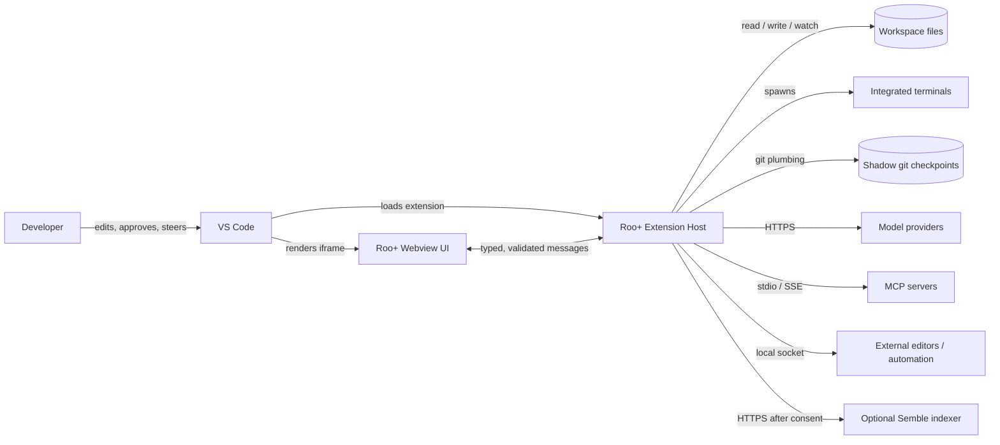
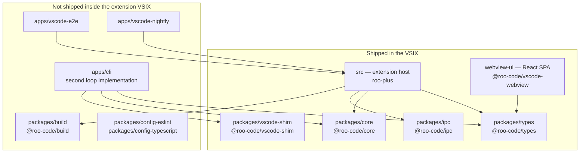
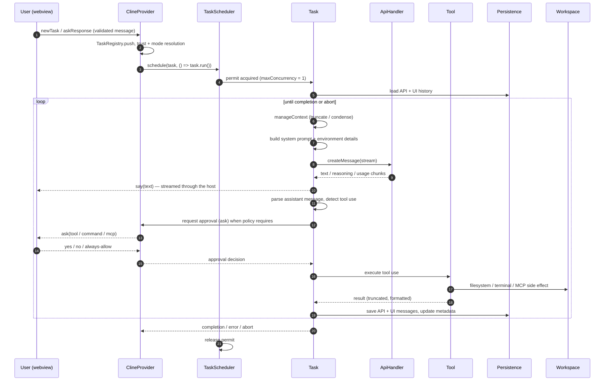
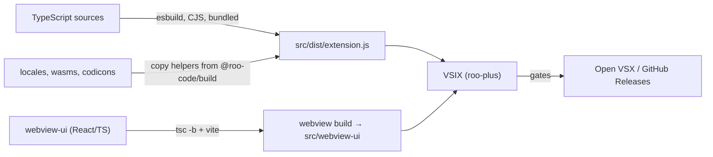

# Roo+ Architecture

| Field              | Value                                                               |
| ------------------ | ------------------------------------------------------------------- |
| **Status**         | Living document (authoritative overview)                            |
| **Owner**          | Repository maintainer                                               |
| **Snapshot**       | `master` @ `a86996d`, reviewed 2026-10-22                           |
| **Audience**       | Contributors, reviewers, security assessors, downstream integrators |
| **Classification** | Public (repository documentation)                                   |

Roo+ is a **VS Code extension that runs an agentic coding loop against models the user
supplies**. This document describes how that is built: the containers that make up the
monorepo, the components inside the extension host, the protocols and invariants that hold
them together, the trust boundaries an attacker would probe, and the constraints that keep
the codebase maintainable.

It is a _living operational document_ in the sense defined by the
[Documentation & ADR Protocol](../src/docs/README.md): it describes **how the system works
today** and is updated as the system changes. The _why_ behind individual decisions lives in
[`docs/adr/`](adr/ADR-INDEX.md).

---

## 1. How to read this document

Sections 2–6 give the shape of the system top-down (context → containers → components →
lifetimes). Sections 7–12 describe it in motion (a request, a state update, a tool call, a
write). Sections 13–17 are cross-cutting: trust, extensibility, shipping, quality, and
failure handling. Sections 18–21 are the maintenance contract: decisions already made, debt
knowingly carried, invariants you must not break, and vocabulary.

Every structural claim is linked to the file that implements it. Line numbers are omitted on
purpose; symbols and paths survive refactors, line numbers do not. **Numbers are snapshots**
and are re-derived in Appendix B.

**Conventions**

- **Host** = the VS Code extension-host process (Node.js). **Webview** = the React app in
  VS Code's sandboxed iframe. **Task** = one agent conversation with its own history,
  checkpoints, and lifecycle.
- Claims enforced outside the type system are labelled **[policy]** and name their gate.
- **Fact** means "read out of the source at the snapshot commit". **Intent** means "what the
  code is trying to do".

---

## 2. What the system is — and what it is not

**Is.** A local-first agentic IDE extension. It reads and writes your workspace, runs terminal
commands, calls model APIs with credentials you provide, and persists conversations on your
disk. Architecturally, it is a **supervisor of long-running, tool-using model sessions**.

**Is not.** A cloud service. There is no backend control plane — the Roo Code Cloud
integration was removed in [ADR: Remove Roo Code Cloud Integration](adr/adr-cloud-removal.md)
— and no product analytics SDK is a dependency (the removal of `posthog-js` is recorded as a
comment in [`pnpm-workspace.yaml`](../pnpm-workspace.yaml) and no analytics package remains in
the lockfile). The extension is functional offline except for the model calls the user
configures, optional embedding calls when indexing is enabled, MCP servers the user adds, and
the consented Semble download.

That single decision drives most of the rest: with no server, **the extension host is the
trust boundary**, **the filesystem is the database**, and **the webview is untrusted input**.

---

## 3. Architectural drivers

| Driver                                     | Consequence in the code                                                                                                                                                 |
| ------------------------------------------ | ----------------------------------------------------------------------------------------------------------------------------------------------------------------------- |
| **Bring-your-own-model, many providers**   | A narrow `ApiHandler` contract and one factory ([`buildApiHandler`](../src/api/index.ts)) with 34 provider arms, rather than provider-specific logic in the agent loop. |
| **Local-first, no control plane**          | State ownership in `ContextProxy` over VS Code global state + SecretStorage; conversations as files under a configurable storage root.                                  |
| **The agent writes to the real workspace** | Layered approvals, diff-first edits, ignore/protected-file controllers, workspace-trust gating (section 13).                                                            |
| **Two processes, one product**             | A typed message protocol as the only coupling between host and webview (section 8).                                                                                     |
| **Fork with an upstream**                  | Fork layers isolated; upstream-owned code diff-gated ([ADR: Upstream-Alignment Fork Strategy](adr/adr-upstream-alignment-fork-strategy.md)).                            |
| **Long-lived, resumable sessions**         | Tasks are first-class objects with persistent history, checkpoints, and a registry that can hold several (section 12).                                                  |
| **A shipping product**                     | Packaging budgets, VSIX audits, release versioning policy, and a test pyramid enforced in CI (sections 15–16).                                                          |

### 3.1 Non-goals

- Multi-tenant or server-side execution of agent loops.
- Silent auto-approval of destructive operations: the trust ladder is explicit and
  user-controlled; untrusted workspaces cannot auto-approve sensitive asks.
- Provider parity at the cost of a lowest-common-denominator abstraction — capabilities
  (images, reasoning, prompt caching, native tool calling) are negotiated per model.

---

## 4. System context

| Neighbour                      | Relationship                                                                           | Boundary crossing                                                                                |
| ------------------------------ | -------------------------------------------------------------------------------------- | ------------------------------------------------------------------------------------------------ |
| **VS Code**                    | Host platform: extension host, webview hosting, commands, terminal and workspace APIs. | Declares `untrustedWorkspaces.supported: false` in [`src/package.json`](../src/package.json).    |
| **Webview UI**                 | React SPA in a sandboxed iframe. Never trusted to send well-formed input.              | `postMessage` only, validated at both ends (section 8).                                          |
| **Model providers**            | 34 provider arms; OpenAI-compatible and self-hosted routes share one shape.            | Credentials never leave the host; the webview sees masked/absent secrets.                        |
| **MCP servers**                | User-configured external tool servers, global and project scoped.                      | Mode filtering, per-server approval, process-wide lifecycle (section 6.4).                       |
| **Workspace / terminal / git** | The blast radius.                                                                      | Ignore rules, protected files, destructive-command guard, per-edit approval.                     |
| **Semble indexer**             | Optional code-index backend, downloaded at first use after consent, SHA-256 pinned.    | Explicit consent + checksum verification ([binary ADR](adr/adr-binary-acquisition-strategy.md)). |
| **External automation**        | Editors and scripts driving the running extension.                                     | Public `API` + local `IpcServer` in [`src/extension/api.ts`](../src/extension/api.ts).           |

---

## 5. Container view — the monorepo

A **pnpm workspace driven by Turborepo** ([`pnpm-workspace.yaml`](../pnpm-workspace.yaml),
[`package.json`](../package.json)). Four kinds of container: the extension (`src`), the UI
(`webview-ui`), shared libraries (`packages/*`), and satellites (`apps/*`).

| Container           | Package                    | Responsibility                                                                                                                                                                                                                 | Entry point                                                     |
| ------------------- | -------------------------- | ------------------------------------------------------------------------------------------------------------------------------------------------------------------------------------------------------------------------------ | --------------------------------------------------------------- |
| **Extension host**  | `roo-plus`                 | Activation, webview hosting, task engine, providers, tools, persistence, services, integrations.                                                                                                                               | [`src/extension.ts`](../src/extension.ts)                       |
| **Webview UI**      | `@roo-code/vscode-webview` | Chat, settings, history, marketplace, diff review. React 18 + Vite + Tailwind 4 + Radix.                                                                                                                                       | [`webview-ui/src/index.tsx`](../webview-ui/src/index.tsx)       |
| **Shared types**    | `@roo-code/types`          | Single source of truth for shared types **and** zod schemas: settings, provider settings, model catalogs, both message registries, task/history shapes, tool names.                                                            | [`packages/types/src/index.ts`](../packages/types/src/index.ts) |
| **Shared core**     | `@roo-code/core`           | Runtime code with no VS Code dependency: custom-tool registry, task history, worktree service, message utilities, debug log.                                                                                                   | [`packages/core/src/index.ts`](../packages/core/src/index.ts)   |
| **IPC**             | `@roo-code/ipc`            | Socket transport between the extension and an external process.                                                                                                                                                                | [`packages/ipc/src/index.ts`](../packages/ipc/src/index.ts)     |
| **Build utilities** | `@roo-code/build`          | esbuild helpers (`copyPaths`, `copyWasms`, `copyLocales`) used by the extension and nightly builds.                                                                                                                            | [`packages/build`](../packages/build/package.json)              |
| **VS Code shim**    | `@roo-code/vscode-shim`    | Minimal `vscode` API surface so non-host consumers can run shared code.                                                                                                                                                        | `packages/vscode-shim`                                          |
| **CLI**             | `@roo-code/cli`            | Headless agent — an **in-process second implementation** of the loop over the shim, with its own host harness and message processor. Released as its own artefact ([`cli-release.yml`](../.github/workflows/cli-release.yml)). | [`apps/cli/src/index.ts`](../apps/cli/src/index.ts)             |
| **E2E / nightly**   | —                          | Real-extension-host test harness; nightly build channel.                                                                                                                                                                       | `apps/vscode-e2e`, `apps/vscode-nightly`                        |

**Why the split exists.** [`@roo-code/types` was extracted](adr/adr-shared-types-package.md)
so types and runtime schemas cannot drift and so extension, CLI, and webview agree on the
protocol. [`@roo-code/core`](../packages/core/src/index.ts) exists so non-VS-Code-shaped logic
is reusable and unit-testable without a host. `packages/core` is not a dumping ground: it
holds code that has no business importing `vscode`.

**What the CLI is not.** It does not consume `@roo-code/ipc`. It depends on `@roo-code/core`,
`@roo-code/types`, and `@roo-code/vscode-shim`, and embeds its own host emulation
([`apps/cli/src/agent/extension-host.ts`](../apps/cli/src/agent/extension-host.ts),
[`extension-client.ts`](../apps/cli/src/agent/extension-client.ts),
[`message-processor.ts`](../apps/cli/src/agent/message-processor.ts)). That is a **second loop
implementation and a second protocol-validation boundary** — carried as debt in section 19.

---

## 6. Extension-host component view

Components are grouped by the axis they own: **surface** (how the user reaches the system),
**engine** (how a turn is produced), **plumbing** (state and side effects), and **services**
(capabilities with their own lifecycle).

```mermaid
flowchart TB
    subgraph surface["Surface"]
        cp["ClineProvider<br/>webview view provider + task façade"]
        router["webviewMessageHandler<br/>domain router"]
        handlers["handlers/* — 15 domain modules + shared"]
        api["API + IpcServer<br/>automation surface"]
    end

    subgraph engine["Engine"]
        task["Task<br/>agent loop, ask/approve, streaming"]
        orch["TaskOrchestrator<br/>delegation transitions"]
        reg["TaskRegistry"]
        sched["TaskScheduler<br/>semaphore, maxConcurrency = 1"]
        tools["Tool layer<br/>23 tools + MCP tools + custom tools"]
        apih["ApiHandler adapters<br/>buildApiHandler factory"]
    end

    subgraph plumbing["Plumbing"]
        ctx["ContextProxy<br/>global state + secrets"]
        pers["task-persistence<br/>messages, history, metadata"]
        ckpt["checkpoints<br/>per-task shadow git"]
        diff["diff strategies + DiffViewProvider"]
        cm["context management<br/>condense, truncation, mentions"]
        approving["auto-approval + workspace trust"]
    end

    subgraph services["Services / integrations"]
        mcp["McpHub / McpServerManager"]
        index["CodeIndexManager<br/>tree-sitter, embedders, vector store, Semble"]
        skills["SkillsManager"]
        market["MarketplaceService / Manager"]
        term["TerminalRegistry"]
        mdms["MdmService"]
        wt["WorktreeService"]
    end

    router --> handlers --> cp
    cp --> task
    cp --> reg
    cp --> sched
    cp --> orch
    task --> apih
    task --> tools
    task --> cm
    task --> approving
    task --> pers
    task --> ckpt
    task --> diff
    task --> mcp
    task --> ctx
    cp --> index
    cp --> skills
    cp --> market
    cp --> term
    cp --> mdms
    cp --> wt
    api --> cp
```

### 6.1 Surface layer

**[`ClineProvider`](../src/core/webview/ClineProvider.ts)** is the webview view provider and
the façade over everything the UI can ask for. It implements `vscode.WebviewViewProvider` and
a `TaskProviderLike` contract, is registered for the sidebar _and_ a tab panel, and owns the
task registry and scheduler, the lazily built `TaskOrchestrator`, the MCP hub, the skills
manager, the marketplace service, the code-index manager, workspace tracking, the
pending-edit store, the rate-limit clock, the payload/health metrics, and the outbound state
broadcaster.

It is also the **protocol boundary**: inbound messages are parsed and validated before
dispatch; outbound state is throttled before it is posted.

**[`webviewMessageHandler`](../src/core/webview/webviewMessageHandler.ts)** is a thin router.
It builds a `Map<WebviewMessageType, handler>` from fifteen domain modules under
[`src/core/webview/handlers/`](../src/core/webview/handlers/) — chat, task, settings,
provider profiles, MCP, marketplace, worktree, code index, skills, rules, commands, terminal,
images, debug, misc — plus a `shared.ts` of cross-domain helpers. This is the outcome of
[the handler-decomposition ADR](adr/adr-webview-handler-decomposition.md): the monolithic
`switch` was split without changing the exported signature.

_Registered is not the same as handled_: a type can be in the schema registry and still have
no handler (for example `draggedImages`, which is typed but has no dispatch target). Treat the
registry as the protocol contract and the router map as the implementation, and verify
coverage when adding a type.

**Automation surface.** [`src/extension/api.ts`](../src/extension/api.ts) exposes an `API`
class (an `EventEmitter` over `RooCodeEvents`) plus a local `IpcServer`, so external editors
and scripts can start tasks, send messages, and observe events without a webview.

### 6.2 Engine layer

**[`Task`](../src/core/task/Task.ts)** is the agent loop: it owns one conversation, streams
from an `ApiHandler`, parses assistant messages (including native tool calls), executes
tools, collects approvals, manages context, saves checkpoints, and persists messages. It is an
`EventEmitter` (`TaskEvents`) so surfaces can observe it without being coupled to it. It is
also the largest file in the repository — see section 19.

**[`TaskRegistry`](../src/core/task/TaskRegistry.ts)** is an expand-contract replacement for
the old `clineStack: Task[]`. It holds a `Map` for O(1) lookup plus a LIFO stack of IDs and
maintains one invariant: `size === stack.length`. It supports focus switching (`setCurrent`),
running-task queries, and removal by ID.

**[`TaskScheduler`](../src/core/task/TaskScheduler.ts)** is a semaphore-gated runner. It ships
at `maxConcurrency = 1`, which is structurally identical to serial execution but makes future
fan-out a configuration change rather than a rewrite. `cancelQueued()` drains waiting tasks
without disturbing a task that already holds the permit.

**[`TaskOrchestrator`](../src/core/services/TaskOrchestrator.ts)** owns _delegation_ — a
parent task hands off to a child (`new_task`), the child completes, the parent reopens — and
serialises those transitions per parent so concurrent delegations cannot interleave.
Transitions are fail-forward: a failed cancel must not permanently block a later reopen.

**[`ApiHandler`](../src/api/index.ts)** is the model seam: `createMessage` yields an
`ApiStream` of text/reasoning/usage chunks; `getModel()` returns metadata and pricing; an
optional `SingleCompletionHandler` adds one-shot completion. Adapters live under
[`src/api/providers/`](../src/api/providers/), most extending
[`BaseProvider`](../src/api/providers/base-provider.ts); stream and format translation lives
under [`src/api/transform/`](../src/api/transform/). Retired providers are rejected at the
factory instead of failing at call time.

**Tool layer.** [`src/core/tools/`](../src/core/tools/) holds 23 concrete tool implementations
behind [`BaseTool`](../src/core/tools/BaseTool.ts), plus
[`validateToolUse`](../src/core/tools/validateToolUse.ts),
[`ToolRepetitionDetector`](../src/core/tools/ToolRepetitionDetector.ts), and MCP-server
restrictions. Tools are assembled per mode by
[`buildNativeToolsArrayWithRestrictions`](../src/core/task/build-tools.ts), which merges
native, MCP, and custom tools and then filters by mode and disabled-tool settings.

> **The tool contract is wider than it looks.** `BaseTool.execute(params, task: Task,
callbacks)` receives the **entire `Task`**, not a narrow slice of it. Every tool therefore
> has access to the whole agent loop, and every tool is coupled to `Task`'s shape. This is the
> main structural obstacle to extracting cohesive services out of `Task` (section 19, row 1).

### 6.3 Plumbing layer

| Concern                      | Implementation                                                                                                                       | Notes                                                                                           |
| ---------------------------- | ------------------------------------------------------------------------------------------------------------------------------------ | ----------------------------------------------------------------------------------------------- |
| **State of record**          | [`ContextProxy`](../src/core/config/ContextProxy.ts)                                                                                 | Wraps global state + SecretStorage; exports a _reduced_ settings schema for portability.        |
| **Conversation persistence** | [`src/core/task-persistence/`](../src/core/task-persistence/)                                                                        | API messages, UI messages, metadata; task history store with atomic read/update.                |
| **Checkpoints**              | [`src/services/checkpoints/`](../src/services/checkpoints/)                                                                          | Per-task shadow git repository; save/diff/restore.                                              |
| **Edits**                    | [`src/core/diff/`](../src/core/diff/) + [`DiffViewProvider`](../src/integrations/editor/DiffViewProvider.ts)                         | Multi-strategy diff application; the change is visible before it lands.                         |
| **Context**                  | [`context-management/`](../src/core/context-management/), [`condense/`](../src/core/condense/), [`mentions/`](../src/core/mentions/) | Truncation, summarisation, `@`-mention expansion, environment details.                          |
| **Approvals**                | [`src/core/auto-approval/`](../src/core/auto-approval/) + workspace-trust utilities                                                  | Ask-type policy per operation; trust-sensitive asks never auto-approve in untrusted workspaces. |
| **Outbound state**           | `ClineProvider.postStateToWebview*`                                                                                                  | Debounced/throttled; guarded by metrics, boot guard, and liveness probe (section 8.2).          |

### 6.4 Services and integrations

**[`src/services/`](../src/services/)** holds capabilities with independent lifecycles:
MCP, code index, marketplace, skills, rules/`AGENTS.md` loading, slash commands, roo-config
resolution, ripgrep and glob helpers, tree-sitter, binary acquisition and managed binaries,
the destructive-command guard, and MDM policy.

**MCP is process-global, not per-task.** [`McpServerManager`](../src/services/mcp/McpServerManager.ts)
is a promise-locked singleton (`initializationPromise`, `waitUntilReady()`, a
`mcpHubInstanceId` marker in global state, `unregisterProvider()`).
[`McpHub`](../src/services/mcp/McpHub.ts) is client-refcounted — `registerClient()` /
`unregisterClient()` disposes it at zero — and loads **both** global and project
(`.roo/mcp.json`) configuration with separate watchers, plus OAuth support. The trust
consequence is deliberate and worth stating plainly: **modes and approvals are per-task, but
the MCP client is shared by every task in the window.**

**Code index is a pipeline, and it has a privacy consequence.**
[`CodeIndexManager`](../src/services/code-index/manager.ts) sits over an orchestrator, a scan
executor, cache and state managers, a search service, `embedders/`, `processors/` (file
watching), `vector-store/`, and `semble/` (subprocess + downloader + provider). The shape is
scan → chunk → embed → store vectors → search. **Embedding sends workspace code to the
configured embedding provider**, so indexing is opt-in and must not be described as purely
local. Semble is acquired at first use with an explicit, once-per-user consent and a pinned
checksum; DCG ships bundled instead (see section 13.4).

**Worktrees change the meaning of "workspace".**
[`WorktreeService`](../packages/core/src/worktree/worktree-service.ts) is the only
cross-cutting workspace switcher, driven by a dedicated inbound message domain and bridged by
[`src/core/webview/handlers/worktree.ts`](../src/core/webview/handlers/worktree.ts). Switching
a worktree changes a task's `cwd`, partitions history per workspace, and re-scopes
checkpoints — three invariants that are invisible unless you know they exist. Background:
[`docs/incidents/2026-09-23-history-per-workspace.md`](incidents/2026-09-23-history-per-workspace.md).

**Integrations** ([`src/integrations/`](../src/integrations/)): diff view, terminal
(`TerminalRegistry`, `OutputInterceptor`), diagnostics, workspace tracking, themes, and OAuth
managers for OpenAI Codex and Kimi Code (tokens kept in SecretStorage, outside
provider-profile JSON).

### 6.5 Lifecycle and disposal

Three nested lifetimes, and a reviewer must know which one they are reasoning about:

| Lifetime              | Owner                               | What is created                                                                                                                                                                                                                           | Torn down by                                                                                                                                                    |
| --------------------- | ----------------------------------- | ----------------------------------------------------------------------------------------------------------------------------------------------------------------------------------------------------------------------------------------- | --------------------------------------------------------------------------------------------------------------------------------------------------------------- |
| **Process**           | [`activate()`](../src/extension.ts) | Output channel, network proxy (debug only), i18n, settings migration + auto-import, `MdmService`, terminal registry, OAuth managers, `ContextProxy` singleton, code-index managers per folder, MCP singleton, model-cache refresh, `API`. | [`deactivate()`](../src/extension.ts) — deliberately minimal: one log line, `McpServerManager.cleanup()`, terminal profile reset, `TerminalRegistry.cleanup()`. |
| **Provider instance** | Each `ClineProvider`                | Webview view/panel, task registry, scheduler, MCP hub client reference, skills manager, marketplace client, workspace tracker, pending edits, metrics/probe.                                                                              | `ClineProvider.dispose()`, which is ordered.                                                                                                                    |
| **Task**              | `TaskRegistry`                      | `Task` object, event listeners, checkpoint repo handle, queued messages.                                                                                                                                                                  | `evictCurrentTask()` / `removeClineFromStack()`, or provider disposal.                                                                                          |

**Disposal order is an invariant, not an implementation detail.** `ClineProvider.dispose()`
runs: guard re-entry → cancel the throttled state broadcast → dispose metrics, health metrics,
liveness probe → `taskScheduler.cancelQueued()` (so waiting tasks do not hold the event loop)
→ `evictCurrentTask()` once, then drain the registry (the first pop marks an active delegated
child `interrupted`, so it is not persisted as "active" across a reload) → clear pending edits
→ dispose the view and webview resources → dispose registered disposables → workspace tracker
→ MCP hub client → skills manager → marketplace cleanup → custom-modes manager → task history
store → remove from `activeInstances` → remove listeners → unregister from `McpServerManager`.

The ordering exists because the reverse order leaks: a task that saves history after the store
is disposed writes nowhere, and a child task that is not marked `interrupted` resumes into a
parent that no longer exists.

### 6.6 Multi-instance model

`ClineProvider` is **not** a singleton. A static `activeInstances: Set<ClineProvider>` tracks
every live instance; `getInstance()` focuses the sidebar and returns the visible provider, and
`getVisibleInstance()` selects the last visible one. The tab panel path creates an additional
provider bound to `ClineProvider.tabPanelId`.

The load-bearing distinction:

| Scope                     | State                                                                                                                                 |
| ------------------------- | ------------------------------------------------------------------------------------------------------------------------------------- |
| **Per provider instance** | Task registry and scheduler, webview view, pending edits, workspace tracker reference, marketplace client, throttled broadcast.       |
| **Per process**           | `ContextProxy` (global state + secrets), MCP hub (refcounted), `McpServerManager`, code-index managers per folder, terminal registry. |
| **Per task**              | Conversation history, checkpoints, mode, approval decisions, queued messages.                                                         |

Anything added to the "per process" column is shared by a sidebar provider and a tab provider
simultaneously. That has caused at least one production incident
([`docs/incidents/2026-09-23-history-per-workspace.md`](incidents/2026-09-23-history-per-workspace.md)),
so state placement is a design decision, not a convenience.

---

## 7. The agentic request lifecycle

1. **The loop, not the request, is the unit.** A "turn" is indistinguishable from the whole
   task; state is persisted mid-loop, so a crash or window reload is survivable.
2. **Approval is inside the loop.** Tool execution may suspend the loop until the user
   answers, and the answer becomes part of the persisted history.
3. **Context is a budget.** Context is measured and managed before each call; a
   context-window error triggers bounded forced reduction with a retry ceiling.
4. **Concurrency is explicit.** `TaskScheduler` gates execution, so "two tasks running" is a
   deliberate future configuration, not an accident of event ordering.
5. **Everything is observable.** Task events (`RooCodeEventName`) drive both the webview and
   the external API/IPC consumers.

---

## 8. Host ⇄ webview protocol and state synchronisation

The coupling is intentionally narrow: **typed messages, validated at both boundaries, over
`postMessage`.**

### 8.1 How typing actually works

It is worth being precise, because the mechanism is easy to overstate:

- **The message interfaces are hand-written** — `WebviewMessage` and `ExtensionMessage` are
  declared in [`packages/types/src/vscode-extension-host.ts`](../packages/types/src/vscode-extension-host.ts),
  and the type unions are derived from them (`WebviewMessageType = WebviewMessage["type"]`).
- **The zod registries are the runtime contract** —
  [`webview-messages/`](../packages/types/src/webview-messages/index.ts) (inbound) and
  [`extension-messages/`](../packages/types/src/extension-messages/index.ts) (outbound), each
  with a registry keyed by type and a discriminated union built from the registered schemas.
- **The two are reconciled by CI, not by the compiler.** The ratchet
  ([`scripts/message-schema-analysis.mjs`](../scripts/message-schema-analysis.mjs),
  [`scripts/verify-message-schemas.mjs`](../scripts/verify-message-schemas.mjs)) enforces that
  every interface member stays registered and that the untyped count never rises. The
  boundary returns `result.data as WebviewMessage` — a single assertion at the edge, not a
  proof of equivalence.
- **Both boundaries are hard-allowlist and fail-closed**: unknown or malformed messages are
  logged and rejected, never dispatched.
- **Same rule applies twice**: the extension boundary
  ([`ClineProvider.setWebviewMessageListener`](../src/core/webview/ClineProvider.ts)) and the
  CLI's own message processor both validate.

**Four different numbers circulate and they measure different things.** At the snapshot the
inbound schema has 158 discriminated-union entries and 159 registry keys; the outbound schema
has 81 and 81. The CI allowlists (`MESSAGE_SCHEMA_BASELINE` = 153, `EXTENSION_MESSAGE_BASELINE`
= 77) are **not counts** — they are removal guards: the build fails if a listed type disappears
from the registry, and if the untyped count exceeds zero. They are not backfilled when types
are added, so they protect what existed when they were written, not everything that exists now.
[The ADR](adr/adr-typed-message-protocol.md) quotes 155/77, which is a historical snapshot.

Quote the schema counts if a number is needed, and prefer running the verification script over
copying any prose figure (section 19, rows 5, 14).

**Known limitation.** Because the interface is hand-written and the schema is separate, a
field can be added to one side without the compiler complaining. The ratchet catches _missing
types_, not _drifted payload shapes_; the zod `strict`/allow-list choices are what close the
rest. Do not describe this as compiler-enforced single-source-of-truth.

### 8.2 State synchronisation

State flows host → webview as a single `state` message derived from
`getStateToPostToWebview()`. Three guards keep this from becoming the classic
extension-killer:

| Guard                      | Mechanism                                                                                                                                                                                                                                                                                         |
| -------------------------- | ------------------------------------------------------------------------------------------------------------------------------------------------------------------------------------------------------------------------------------------------------------------------------------------------- |
| **Throttled broadcast**    | `debounce(fn, 500, { leading: true, trailing: true, maxWait: 1000 })` — bursts of task events collapse.                                                                                                                                                                                           |
| **Bounded payloads**       | Task history shipped to the webview is capped at **100 rows**, **32 KB**, and **8 ancestor rows** (`MAX_TASK_HISTORY_*` constants in [`TaskHistoryService`](../src/core/services/TaskHistoryService.ts)). Custom modes and chat-message payloads are bounded similarly.                           |
| **Health instrumentation** | [`webviewPayloadMetrics`](../src/core/webview/webviewPayloadMetrics.ts), [`extensionHostHealthMetrics`](../src/core/webview/extensionHostHealthMetrics.ts), [`webviewLivenessProbe`](../src/core/webview/webviewLivenessProbe.ts), [`webviewBootGuard`](../src/core/webview/webviewBootGuard.ts). |

Two distinct facts that are easy to conflate: **history is partitioned per workspace** (the
store), and **the payload is truncated to a fixed budget** (the wire). The bound is a global
constant, not a per-workspace quota.

**Direction of trust.** The webview is treated as a potentially compromised client: it may
send malformed payloads, and it never receives secrets it does not need. Conversely the webview
must not silently drop outbound messages — origin-only trust (not source-string matching) is
what the marketplace-loader regression taught.

### 8.3 Webview composition

[`App.tsx`](../webview-ui/src/App.tsx) mounts provider contexts and routes between chat,
settings, history, marketplace, and mode management. State arrives through an
`ExtensionStateContext`; components consume typed domain slices. Styling is Tailwind 4 with
VS Code CSS variables declared in [`webview-ui/src/index.css`](../webview-ui/src/index.css).
User-supplied content is sanitised before rendering (`dompurify`); markdown/KaTeX/mermaid
rendering is isolated to the display layer. Localisation uses `react-i18next` over the same
18-locale set as the host.

> **Contributor rule.** In `SettingsView`, inputs bind to the local `cachedState` buffer, never
> to live `useExtensionState()`. Live binding causes races where edits are discarded and
> controls visually revert.

---

## 9. Tool execution model

Tools are the only way the model can change the world, so the model is deliberately
constrained: tools are declared per mode, validated before execution, and executed through a
common contract.

1. **Assembly.** `buildNativeToolsArrayWithRestrictions` merges native, MCP, and custom tools,
   then applies mode filtering, disabled-tool settings, and MCP server restrictions.
2. **Validation.** `validateToolUse` rejects unknown tools, missing parameters, and
   mode-disallowed invocations before any side effect. Native tool-call parsing
   ([`NativeToolCallParser`](../src/core/assistant-message/NativeToolCallParser.ts)) is strict.
3. **Execution.** Each tool implements `execute(params, task, callbacks)` against `BaseTool` —
   with the whole `Task` in hand (see the warning in section 6.2) — and reports through
   `callbacks` (`askApproval`, `handleError`, `pushToolResult`).
4. **Feedback.** Results are truncated and formatted
   ([`toolResultFormatting`](../src/core/tools/helpers/toolResultFormatting.ts)) so one
   noisy output cannot consume the context window.
5. **Loop protection.** `ToolRepetitionDetector` stops degenerate repetition; the consecutive
   mistake limit bounds the failure path.

**Edit tools are diff-first.** `ApplyDiffTool`, `SearchReplaceTool`, `SearchAndReplaceTool`,
`ApplyPatchTool`, and `EditFileTool` funnel through the diff-strategy layer, with
`DiffViewProvider` presenting the change in the editor. Among the file-edit tools there is no
silent overwrite path that bypasses the diff machinery — but the guarantee is scoped to tools.
An auto-approved `execute_command` can still write files through the shell (redirection,
`sed -i`, generators), which is why command approval is a separate and higher-consequence
class than edit approval.

---

## 10. Context engineering

| Stage            | Where                                                                                                         | What it does                                                      |
| ---------------- | ------------------------------------------------------------------------------------------------------------- | ----------------------------------------------------------------- |
| **Composition**  | [`src/core/prompts/system.ts`](../src/core/prompts/system.ts), [`prompts/tools/`](../src/core/prompts/tools/) | Mode role, rules, tool descriptions, capability sections.         |
| **Environment**  | [`getEnvironmentDetails.ts`](../src/core/environment/getEnvironmentDetails.ts)                                | Live workspace facts: structure, open tabs, terminal state, time. |
| **Mentions**     | [`processUserContentMentions.ts`](../src/core/mentions/processUserContentMentions.ts)                         | `@`-file/folder/URL expansion with size discipline.               |
| **Tracking**     | [`FileContextTracker.ts`](../src/core/context-tracking/FileContextTracker.ts)                                 | Which files the model has seen, to avoid stale assumptions.       |
| **Management**   | [`src/core/context-management/`](../src/core/context-management/)                                             | Sliding-window truncation and window-exceeded recovery.           |
| **Condensation** | [`src/core/condense/`](../src/core/condense/)                                                                 | Summarise older turns when the budget is exceeded.                |

Token and cost accounting is first-class, not derived: usage chunks are accumulated into
per-request and per-task metrics (`getApiMetrics`, `calculateApiCost*`), and the UI is expected
to show real numbers — the product's stated promise is _legible spend_. When a provider omits
usage, that must surface as "unavailable", never as a fabricated number.

---

## 11. Persistence, state ownership, and settings evolution

| State                                      | Owner                          | Backing store                         | Lifetime                                    |
| ------------------------------------------ | ------------------------------ | ------------------------------------- | ------------------------------------------- |
| User settings, allow-lists, mode selection | `ContextProxy`                 | VS Code global state                  | Profile-scoped, exportable                  |
| Secrets (API keys, OAuth tokens)           | `ContextProxy` / SecretStorage | VS Code SecretStorage                 | Never exported, never posted to the webview |
| Provider profiles                          | `ProviderSettingsManager`      | Settings files under the storage root | Durable, importable                         |
| Custom modes                               | `CustomModesManager`           | Config + workspace files              | Durable                                     |
| Conversation (UI + API messages)           | `task-persistence`             | `<storage root>/tasks/<taskId>/`      | Durable, resumable                          |
| Task history index                         | `TaskHistoryStore`             | Atomic JSON store                     | Durable, bounded                            |
| Checkpoints                                | `RepoPerTaskCheckpointService` | Shadow git repo per task              | Durable, restorable                         |
| Skills / rules                             | `SkillsManager`, rules service | Workspace + user directories          | Durable, hot-reloaded                       |
| Live task objects                          | `TaskRegistry`                 | In-memory                             | Process lifetime                            |

The **storage root** defaults to VS Code's global storage and can be redirected with
`customStoragePath`; an unusable custom path falls back to the default rather than failing
activation ([`src/utils/storage.ts`](../src/utils/storage.ts)).

**Settings are a schema, not a bag of keys.** [`ContextProxy`](../src/core/config/ContextProxy.ts)
validates against `globalSettingsSchema` and exports a _reduced_ schema for import/export
(`taskHistory`, `listApiConfigMeta`, and `currentApiConfigName` are omitted as non-portable).
Schema evolution runs through `migrateSettings` and `autoImportSettings` at activation, which
means a settings change is a migration concern, not just a UI concern.

> **The full round trip, for anyone adding a setting:** schema in
> `packages/types/src/global-settings.ts` → inclusion in `ExtensionState` → `cachedState`
> binding in `SettingsView` → `updateSettings` payload on save → `webviewMessageHandler`
> persistence through `ContextProxy` → `ClineProvider.getState()` default →
> `getStateToPostToWebview()` → consumers → tests that cover both `true` and unset/false.
> Skipping any hop produces a control that saves and then visually reverts.

---

## 12. Concurrency, task lifecycle, and delegation

Three distinct mechanisms, deliberately separate:

- **Registry (identity).** Which tasks exist and which one the UI is focused on. A `Map` plus
  a LIFO stack, with the size invariant maintained in one place.
- **Scheduler (execution).** Which task may run _now_. A semaphore at concurrency 1.
- **Orchestrator (coordination).** How parent and child hand control back and forth. Locked per
  parent, fail-forward.

Splitting these means the hard part — delegation transitions — is testable without a running
extension host, and the concurrency policy is one number.

---

## 13. Trust, safety, and security architecture

The threat model is unusual: the user _intends_ to let a model write files and run commands,
so "deny everything" is not the goal. The goal is **no unreviewed, unrecoverable surprise**.

### 13.1 Trust boundaries

| Boundary           | Attacker-controlled input                         | Control                                                                       |
| ------------------ | ------------------------------------------------- | ----------------------------------------------------------------------------- |
| Webview → host     | Any JSON                                          | Fail-closed zod allow-list; strict per-type validation                        |
| Model → tools      | Arbitrary tool arguments                          | Tool validation, path checks, mode restrictions, approval classes             |
| Workspace → host   | Repository files, rules, `.rooignore`, mode files | Workspace-trust gating; ignore controller; protected-file controller          |
| MCP servers → host | Tool descriptors, results, stderr                 | Server allow/deny, mode filtering, per-server approval, stderr classification |
| Network → host     | Provider responses, binary downloads              | Pinned versions + SHA-256 verification + explicit consent                     |
| Host → disk        | —                                                 | Atomic writes; checkpoints around edits                                       |

### 13.2 Layers of defence, in order

1. **Workspace trust.** `untrustedWorkspaces.supported: false`, with restricted configuration
   keys declared in [`src/package.json`](../src/package.json). In an untrusted workspace,
   command/tool/MCP asks can never be auto-approved even if settings say so
   (`WORKSPACE_TRUST_SENSITIVE_ASKS` in [`Task.ts`](../src/core/task/Task.ts)).
2. **Approval policy.** [`auto-approval`](../src/core/auto-approval/) evaluates each ask class;
   the user owns the trust ladder. Editing a protected file, matching a deny rule, or leaving
   the workspace escalates to an explicit ask.
3. **Ignore and protect controllers.** `RooIgnoreController` (workspace ignore semantics) and
   `RooProtectedController` (files never written without explicit permission).
4. **Command governance.** Allowed/denied lists, per-command timeouts, and the
   [`destructive-command-guard`](../src/services/destructive-command-guard/).
5. **Diff-first edits.** The change is shown before it is applied; checkpoints make it
   reversible.
6. **Binary hygiene.** See 13.4 — consent, checksums, disclosure.
7. **Secret confinement.** Credentials live in SecretStorage; provider-profile JSON never
   carries tokens that belong there.
8. **Policy overrides.** `MdmService` applies administrator policy; conflicting user settings
   lose.

### 13.3 Privacy posture

There is no analytics SDK and no remote crash telemetry. Egress is not "nothing" — it is a
specific, enumerable list, and every claim about privacy should be written against that list:

1. **Inference calls** to the provider the user configured.
2. **Model-catalogue and metadata lookups** for provider panels (a catalogue request is not a
   model request, but it is a network call).
3. **Embedding calls** when codebase indexing is enabled — this sends workspace code to the
   configured embedding provider and must be described as such in product copy.
4. **MCP servers** the user adds, over stdio or SSE, which can carry arbitrary workspace
   content.
5. **OAuth token exchange** for provider subscription flows.
6. **The consented Semble download** (once per pinned version).

Nothing else leaves the machine by design. When adding a network path, add it to this list in
the same change — an incomplete enumeration is worse than no enumeration, because it reads as a
guarantee.

### 13.4 Binary acquisition — two different models

These are deliberately not the same mechanism, and conflating them produces incorrect
compliance claims:

| Component                           | Model                                                       | Verification                                                                                       | User experience                                                                                               |
| ----------------------------------- | ----------------------------------------------------------- | -------------------------------------------------------------------------------------------------- | ------------------------------------------------------------------------------------------------------------- |
| **Semble** (code-index backend)     | **Runtime download** at first use                           | Version-pinned + SHA-256 verified; release governance enforced by `verify-semble-release-coupling` | Consent prompt per pinned version — a version bump prompts again — naming source, version, size, and checksum |
| **DCG** (destructive-command guard) | **Bundled** in the VSIX (five upstream archives, ~+22.5 MB) | Verified twice — archive and extracted executable                                                  | No download; consent governs _execution_, and attribution ships in `THIRD-PARTY-NOTICES.md`                   |

The [binary ADR](adr/adr-binary-acquisition-strategy.md) was **revised on 2026-10-21**: Semble
keeps its runtime download (option 2a was withdrawn), DCG stays bundled (option 3a). Any
document or UI text claiming "Roo+ installs nothing" is wrong for Semble.

> **Live contradiction in the register.** [`ADR-INDEX.md`](adr/ADR-INDEX.md) row 1 still
> summarises Semble as "detect-and-guide only (2a): Roo+ never downloads, installs, mirrors or
> redistributes it". The ADR body and the downloader say the opposite. The index is wrong and
> must not be quoted until it is fixed (section 19, row 13). This is exactly why an index row
> should point at a decision, never paraphrase one.

### 13.5 The risk that is not a boundary: prompt injection

Every control above assumes a human decides what the model may do. The dominant real-world risk
is different in kind: **the model is an untrusted interpreter of untrusted content**. Repository
files, rules files, web content pulled in through mentions, MCP tool output, terminal output,
and command output all enter the context window, and the model then chooses tools.

There is no complete defence, and this document will not pretend otherwise. What exists is a set
of blast-radius limits:

- tool availability is narrowed per mode, so a mode without write tools cannot be talked into
  writing;
- an approval sits between a proposed tool use and its effect, and untrusted workspaces cannot
  auto-approve command, tool, or MCP asks;
- edits are diff-first and checkpointed, so a hostile edit is visible and reversible;
- protected files and ignore rules constrain path-based attacks;
- the destructive-command guard filters command-shaped attacks.

What does **not** exist: provenance tagging of context, an instruction/content separation the
model is bound to honour, or a sandbox around `execute_command`. Auto-approval is therefore the
load-bearing control, and its breadth — each "always allow" a user grants — is the real attack
surface. Treat any change that widens auto-approval as a security change, not a UX change.

---

## 14. Extensibility model

Five seams, ascending in power:

| Seam                     | Mechanism                                                                                                                   | Where                                                                                                               |
| ------------------------ | --------------------------------------------------------------------------------------------------------------------------- | ------------------------------------------------------------------------------------------------------------------- |
| **Modes**                | Role definition, tool allow-list, instructions per mode; 90 pre-loaded from a canonical catalog.                            | [`custom-modes/`](../custom-modes/), `CustomModesManager`, [catalog ADR](adr/adr-custom-modes-canonical-catalog.md) |
| **Rules and skills**     | `AGENTS.md`/`CLAUDE.md`-compatible rules plus `.roo/skills` procedures surfaced by `SkillTool`.                             | [`services/rules/`](../src/services/rules/), [`services/skills/`](../src/services/skills/)                          |
| **Commands**             | Slash commands resolved from workspace/user scope with pre-flight validation.                                               | `commands` handler, `RunSlashCommandTool`                                                                           |
| **Tools**                | MCP servers (external) and custom tools (registered with `customToolRegistry`, built by a lazily installed esbuild engine). | `McpHub`, [`packages/core/src/custom-tools/`](../packages/core/src/custom-tools/)                                   |
| **Programmatic control** | Public `API` + IPC for editors and automation.                                                                              | [`src/extension/api.ts`](../src/extension/api.ts)                                                                   |

The pattern is consistent: **extensions declare capabilities; the core decides whether and how
to execute them.** No extension point bypasses approval, mode filtering, or validation.

**Gap worth closing:** the _precedence_ between workspace-scoped and user-scoped rules,
skills, and commands is not documented anywhere in the repository. Until it is, treat
precedence as undefined behaviour and do not rely on it in new features (section 19, open
questions).

---

## 15. Build, packaging, and distribution

- **Orchestration.** Turborepo over pnpm workspaces; `build`, `bundle`, `vsix`, `test`, `lint`,
  `check-types` are top-level tasks ([`package.json`](../package.json)).
- **Extension bundle.** esbuild produces one CommonJS bundle with source maps always enabled
  ([`src/esbuild.mjs`](../src/esbuild.mjs)). Shared copy helpers come from
  [`@roo-code/build`](../packages/build/package.json).
- **Webview.** Vite build into `src/webview-ui`; build parity with the extension is CI-checked.
- **Packaging budgets.** `verify:vsix-budget`, `verify:vsix-audit`, and
  `verify:third-party-notices` gate what can ship. The release version is whatever
  [`src/package.json`](../src/package.json) declares; it is never derived at build time.
- **Versioning.** The committed version **is** the published version; pre-releases are
  consecutive patches on a minor and the stable is the next patch on that same minor
  ([release-versioning ADR](adr/adr-release-versioning-policy.md)). Announcements are keyed to
  the line base, not each build.
- **Publishing.** `master` is the only publishing branch; the pre-release workflow queries the
  registry and refuses a version that already exists or regresses on its minor. See
  [`docs/runbooks/release-publishing.md`](runbooks/release-publishing.md).
- **Fork hygiene.** Upstream-owned code is diff-gated against the pinned upstream
  ([fork strategy](adr/adr-upstream-alignment-fork-strategy.md),
  [triage strategy](adr/adr-upstream-sync-triage-strategy.md)).

---

## 16. Quality architecture

| Layer           | Scope                                                                                                    | Tool of record                                    |
| --------------- | -------------------------------------------------------------------------------------------------------- | ------------------------------------------------- |
| **Unit**        | Pure logic: parsing, state transitions, request construction, retry policy, schema validation, cost math | Vitest, package-local                             |
| **Integration** | Multi-module contracts without a real host (orchestrator, registry, persistence)                         | Vitest + typed doubles                            |
| **Webview**     | React rendering, hooks, form validation, message wiring                                                  | Vitest in `webview-ui`                            |
| **E2E**         | Real extension host, real workspace, end-to-end workflows                                                | [`apps/vscode-e2e`](../apps/vscode-e2e)           |
| **Visual**      | Rendered UI regression                                                                                   | Playwright component tests                        |
| **Static**      | Types, lint (per-file suppression ratchet), dependency hygiene                                           | `check-types`, `eslint-suppressions.json`, `knip` |

Two ratchets encode architecture rather than style:

- **Protocol ratchet** — every inbound/outbound type stays schema-registered; the untyped count
  cannot rise above zero.
- **Lint suppression ratchet** — per-file suppression counts may never increase; paying down
  when you touch a file is preferred over adding new ones.

CI workflows ([`.github/workflows/`](../.github/workflows/)) cover QA, CodeQL, dependency
auto-merge, e2e, visual regression, release validation, pre-release publishing, and
marketplace publishing.

---

## 17. Observability and failure handling

### 17.1 Logging

Two loggers are created at activation and injected: `createOutputChannelLogger` (VS Code output
channel) and `createDualLogger` ([`src/utils/outputChannelLogger`](../src/utils/outputChannelLogger.ts)).
`@roo-code/core` additionally ships a [`debug-log`](../packages/core/src/debug-log/) facility
for structured host-side traces. Diagnostics are produced by
[`scripts/host-health-capture.sh`](../scripts/host-health-capture.sh) against the template in
[`docs/runbooks/host-health-analysis-template.md`](runbooks/host-health-analysis-template.md).

**Redaction rule.** Logs must never contain API keys, OAuth tokens, or full file contents.
Metrics that cross into the webview are numeric-only by policy — routing them to any remote
sink would require a privacy review.

### 17.2 Failure classes

| Failure                       | Handling                                                                                      | Ceiling                                                                     | What the user sees                             |
| ----------------------------- | --------------------------------------------------------------------------------------------- | --------------------------------------------------------------------------- | ---------------------------------------------- |
| Provider rate limit           | Wait and retry; `RateLimitClock` spreads retries across tasks                                 | Exponential backoff capped at **600 s** (`MAX_EXPONENTIAL_BACKOFF_SECONDS`) | `api_req_retry_delayed` with a countdown timer |
| Transient provider error      | Classified in [`error-handler.ts`](../src/api/providers/utils/error-handler.ts), then retried | Same backoff ceiling                                                        | Error, then automatic retry                    |
| Context window exceeded       | Forced reduction to 75% of context, then retry                                                | 3 attempts (`MAX_CONTEXT_WINDOW_RETRIES`)                                   | Context-truncation notice                      |
| Repetitive tool use           | `ToolRepetitionDetector` trips                                                                | `consecutiveMistakeLimit`                                                   | Ask to intervene                               |
| Scheduler failure             | Caught and logged per source; permit released in `finally`                                    | —                                                                           | Task does not start; error surfaced in logs    |
| Delegation transition failure | Fail-forward: the lock chain continues                                                        | —                                                                           | Parent still reopens correctly                 |
| Task abort                    | `AskIgnoredError` / abort flag unwinds the loop                                               | —                                                                           | Task stops cleanly; history preserved          |

This table is the answer to "what happens during a provider outage" — a question the document
should be able to answer without reading `Task.ts`.

---

## 18. Architectural decision register

| Decision                                                                        | Status                           | Architectural effect                                                                              |
| ------------------------------------------------------------------------------- | -------------------------------- | ------------------------------------------------------------------------------------------------- |
| [Typed + runtime-validated message protocol](adr/adr-typed-message-protocol.md) | Accepted, migration complete     | Protocol is a schema registry; both boundaries fail closed. **Counts in the ADR text are stale.** |
| [Domain-split webview handlers](adr/adr-webview-handler-decomposition.md)       | Accepted                         | Router + 15 domain modules instead of one `switch`.                                               |
| [Shared `@roo-code/types`](adr/adr-shared-types-package.md)                     | Accepted                         | One package owns types and schemas; extension, CLI, webview consume it.                           |
| [Upstream-alignment fork strategy](adr/adr-upstream-alignment-fork-strategy.md) | Accepted                         | Upstream code diff-gated; fork layers isolated.                                                   |
| [Upstream sync triage](adr/adr-upstream-sync-triage-strategy.md)                | Accepted                         | Every upstream commit classified before porting.                                                  |
| [Unified release versioning](adr/adr-release-versioning-policy.md)              | Accepted                         | Committed version == published version; line-keyed announcements.                                 |
| [Binary acquisition strategy](adr/adr-binary-acquisition-strategy.md)           | Accepted, **revised 2026-10-21** | Semble downloads at first use; DCG is bundled and disclosed.                                      |
| [Semble download-only distribution](adr/adr-semble-binary-download-only.md)     | Accepted                         | No redistribution of the external indexer.                                                        |
| [Canonical custom-modes catalog](adr/adr-custom-modes-canonical-catalog.md)     | Accepted                         | One catalog generates all packaged mode artifacts.                                                |
| [Cloud integration removal](adr/adr-cloud-removal.md)                           | Accepted                         | No backend control plane; local-first is structural.                                              |
| [Node.js 22](adr/adr-nodejs-v22.md)                                             | Accepted                         | Engine floor for the workspace.                                                                   |
| [Bulk install modes](adr/adr-bulk-install-modes.md)                             | Accepted                         | Marketplace batch operations.                                                                     |

Governance documents outside the ADR set: [branch hygiene](runbooks/branch-hygiene.md),
[release publishing](runbooks/release-publishing.md),
[gray-webview runbook](runbooks/gray-webview.md),
[Semble release governance](SEMBLE-RELEASE-GOVERNANCE.md),
[DCG release governance](DCG-RELEASE-GOVERNANCE.md),
[upstream sync runbook](runbooks/upstream-sync.md).

---

## 19. Known debt, risks, and open questions

An architecture document that only lists strengths is marketing. These are the verifiable weak
points, ordered by consequence.

| #   | Debt                                                                 | Evidence                                                                                                                                                                                                                            | Consequence                                                                                                                            | Direction                                                                                                                                                            |
| --- | -------------------------------------------------------------------- | ----------------------------------------------------------------------------------------------------------------------------------------------------------------------------------------------------------------------------------- | -------------------------------------------------------------------------------------------------------------------------------------- | -------------------------------------------------------------------------------------------------------------------------------------------------------------------- |
| 1   | **Oversized orchestrators.**                                         | `Task.ts` ≈ 4,830 lines; `ClineProvider.ts` ≈ 3,400; `TaskOrchestrator.ts` ≈ 1,490.                                                                                                                                                 | Review fatigue, merge conflicts, slow feedback, high regression risk in the core loop. Compounded by tools receiving the whole `Task`. | Continue the extract-service pattern (`TaskOrchestrator`, `TaskHistoryService`): pull approvals, streaming, and persistence out of `Task`; narrow the tool contract. |
| 2   | **Duplicated transition helpers — one copy dead.**                   | `runDelegationTransition` is defined in `ClineProvider.ts` **and** `TaskOrchestrator.ts`; the `ClineProvider` copy has no call site (coverage reports it as never executed). `scheduleTask` is duplicated and both copies are live. | A fix applied to one copy silently misses the other; dead code misleads readers about the delegation path.                             | Delete the dead copy; extract the live one into a shared module.                                                                                                     |
| 3   | **`ClineProvider` ↔ `Task` source-level cycle.**                     | `Task` imports `ClineProvider`; the orchestrator deliberately keeps a type-only import to avoid adding a runtime edge "to the existing ClineProvider↔Task cycle".                                                                   | TypeScript currently elides the runtime edge; nothing prevents it from becoming a real cycle.                                          | Make the import `import type`, depend on a narrow `TaskProvider` interface, and add a lint rule.                                                                     |
| 4   | **CLI is a second implementation and a second validation boundary.** | `apps/cli` does not use `@roo-code/ipc`; it vendors its own host harness, client, and message processor.                                                                                                                            | Two loops and two protocol boundaries drift independently; bug fixes must land twice.                                                  | Decide: thin IPC client, or explicitly maintained second implementation with shared conformance tests.                                                               |
| 5   | **Protocol numbers are quoted inconsistently.**                      | Registries: 158 inbound / 81 outbound. CI allowlists: 153 / 77 — a removal guard, not a census. ADR text: 155 / 77.                                                                                                                 | Readers cannot tell which number is authoritative; documentation that looks verified reproduces stale figures.                         | Report only generated numbers, and generate them into the ADR instead of hand-writing them.                                                                          |
| 6   | **Documentation structure inconsistency.**                           | [`src/docs/README.md`](../src/docs/README.md) says ADRs live in `src/docs/`; they live in `docs/adr/`. [`ADR-INDEX.md`](adr/ADR-INDEX.md) links a local `README.md` and two `arch-review-*.md` files that do not exist.             | New contributors file decisions in the wrong place; the index misleads.                                                                | Make `docs/adr/` canonical, fix the protocol doc and index, add a link check over the ADR directory.                                                                 |
| 7   | **`DEBT.md` is partly stale.**                                       | It references `packages/telemetry/CHANGELOG.md`; there is no `packages/telemetry` in the workspace.                                                                                                                                 | The register loses authority precisely because this document cites it.                                                                 | Prune resolved rows; add a CI check that every path in `DEBT.md` exists.                                                                                             |
| 8   | **README duplication is unenforced.**                                | `README.md` and `src/README.md` are byte-identical today; nothing compares them ([`DEBT.md`](../DEBT.md)).                                                                                                                          | Silent divergence on the next single-sided edit.                                                                                       | Extend the locale-README gate to cover the `src/` copy.                                                                                                              |
| 9   | **No enforced coverage threshold.**                                  | [`DEBT.md`](../DEBT.md).                                                                                                                                                                                                            | Test volume is visible; coverage can regress unseen.                                                                                   | Ratchet a per-package threshold rather than one global number.                                                                                                       |
| 10  | **Concurrency is designed-in but unexercised.**                      | `TaskScheduler` ships at `maxConcurrency = 1`.                                                                                                                                                                                      | Fan-out claims are intent, not proven behaviour.                                                                                       | Keep the semaphore as the only gate; add a multi-task integration test before raising it.                                                                            |
| 11  | **`apps/docs` is an empty scaffold.**                                | Directory contains only `node_modules`; no `package.json`.                                                                                                                                                                          | It appears in workspace globs and in reader expectations, but does nothing.                                                            | Remove it or make it real.                                                                                                                                           |
| 12  | **Cost legibility depends on provider data.**                        | Usage is accumulated from stream chunks.                                                                                                                                                                                            | A provider that omits usage degrades the product's core promise.                                                                       | Explicit "usage unavailable" state; never fabricate.                                                                                                                 |
| 13  | **The ADR index contradicts a revised ADR.**                         | `ADR-INDEX.md` row 1 still says Semble is "detect-and-guide only … never downloads"; the ADR body (revised 2026-10-21) and the downloader say it downloads at first use.                                                            | An auditor quoting the register gets the opposite compliance posture from the code.                                                    | Reconcile the index; treat index rows as pointers, never as summaries of a revised decision.                                                                         |
| 14  | **Ratchet allowlists are not backfilled.**                           | 6 inbound and 4 outbound registered types are absent from `MESSAGE_SCHEMA_BASELINE` / `EXTENSION_MESSAGE_BASELINE`.                                                                                                                 | A newly added type can be removed without failing CI; the guard covers only types that existed when it was written.                    | Generate the baselines from the registry, or require a baseline entry in the same change that adds a type.                                                           |
| 15  | **Stale docstrings describe a boundary that no longer exists.**      | `webview-messages/index.ts` and `extension-messages/index.ts` both still state that unregistered types "pass through structurally", while the parser rejects them.                                                                  | Readers believe there is a pass-through path; contributors may design around one that does not exist.                                  | Fix the docstrings — they are the first thing a contributor reads.                                                                                                   |
| 16  | **No retention or erasure story.**                                   | Task history, checkpoints, and provider profiles are plaintext files under a configurable root.                                                                                                                                     | "Delete my data" is a manual filesystem operation with no documented contract.                                                         | Document retention and the delete path; consider a retention setting.                                                                                                |

### 19.1 Open questions worth an ADR

1. **Rules/skills/commands precedence** between workspace and user scope is undocumented.
2. **Should `Task` own approval state**, or should approvals move to the orchestrator so the
   loop only queries a policy service?
3. **Should the outbound `state` message become incremental patches** instead of full
   snapshots? The payload bounds are a mitigation, not a fix.
4. **What is the CLI's contract?** Thin client over IPC, or a supported second implementation
   with conformance tests. Today it is the latter by accident.
5. **Should MCP be per-provider-instance** rather than process-global, now that multiple
   providers can exist in one window?
6. **Which platforms are first-class?** DCG bundles five archives and Semble's acquisition is
   platform-gated, but no published support matrix says what degrades where.

---

## 20. Change guide — invariants you must not break

1. **Never bypass the protocol boundary.** A new message needs a schema, a registry entry, a
   handler, and a sender in the same change; the ratchet must not be relaxed.
2. **Never send secrets to the webview.** Send a masked boolean, never the value.
3. **Never add an auto-approval path that ignores workspace trust.** Command, tool, and MCP
   asks must escalate in untrusted workspaces.
4. **Never write user-visible files outside the diff/approval pipeline.**
5. **Never let a task's state live only in memory.** Persist before and after tool execution.
6. **Never add `as any` to escape a message type.** Fix the schema or the consumer.
7. **Never increase a file's lint suppression count.**
8. **Never put `vscode`-dependent code in `packages/core`.**
9. **Never add per-process state casually.** Check section 6.6 first: it is shared by every
   provider instance in the window.
10. **Never change a setting's round trip partially.** See the checklist in section 11.
11. **Never publish by mutating the version at build time.**
12. **Never describe the protocol as compiler-enforced.** It is CI-reconciled (section 8.1).

---

## 21. Glossary

| Term                    | Meaning                                                                                              |
| ----------------------- | ---------------------------------------------------------------------------------------------------- |
| **Task**                | One agent conversation with history, checkpoints, and lifecycle.                                     |
| **Provider instance**   | One `ClineProvider` bound to a webview (sidebar or tab). Not a singleton.                            |
| **Ask / Say**           | Task-level UI messaging: host asks for a decision; host says a state update.                         |
| **Mode**                | Role definition plus tool allow-list and instructions; drives prompt composition and tool filtering. |
| **ApiHandler**          | Model-provider adapter contract (`createMessage` streaming + model metadata).                        |
| **Checkpoint**          | Shadow-git snapshot of the workspace around edits, restorable per task.                              |
| **Condense / truncate** | Summarise or window old context to stay inside the model budget.                                     |
| **Delegation**          | A parent task handing work to a child task and later reopening.                                      |
| **MCP**                 | Model Context Protocol — external tool servers.                                                      |
| **Skill**               | A procedure document under `.roo/skills/` surfaced through `SkillTool`.                              |
| **VSIX**                | The packaged VS Code extension artifact.                                                             |
| **DCG**                 | Destructive-command guard — bundled, checksum-verified, disclosed.                                   |
| **Semble**              | Optional external code-index backend, downloaded on first use after consent.                         |

---

## Appendix A — Directory map

| Path                                            | Contains                                                                                           |
| ----------------------------------------------- | -------------------------------------------------------------------------------------------------- |
| [`src/activate/`](../src/activate/)             | Command, code-action, terminal-action, and URI registration.                                       |
| [`src/api/`](../src/api/)                       | `ApiHandler`, provider adapters, model fetchers, stream/format transforms.                         |
| [`src/core/`](../src/core/)                     | Task engine, webview provider, tools, prompts, diff, checkpoints, context, approvals, persistence. |
| [`src/extension/`](../src/extension/)           | Public `API` and IPC surface.                                                                      |
| [`src/integrations/`](../src/integrations/)     | Editor, terminal, diagnostics, workspace, themes, OAuth.                                           |
| [`src/services/`](../src/services/)             | MCP, code index, marketplace, skills, rules, commands, binaries, MDM, search.                      |
| [`src/shared/`](../src/shared/)                 | Cross-cutting helpers without host coupling (modes, costs, combine-\*, package metadata).          |
| [`src/i18n/`](../src/i18n/)                     | Host-side localisation — 18 locales.                                                               |
| [`src/workers/`](../src/workers/)               | Worker entry points used by the bundle.                                                            |
| [`webview-ui/src/`](../webview-ui/src/)         | React app: components, contexts, hooks, i18n, lib.                                                 |
| [`packages/types/src/`](../packages/types/src/) | Types, zod schemas, registries, model catalogs.                                                    |
| [`packages/core/src/`](../packages/core/src/)   | VS Code-free runtime shared with the CLI.                                                          |
| [`apps/cli/src/`](../apps/cli/src/)             | Headless agent, commands, UI, message processor.                                                   |
| [`docs/`](../docs/)                             | Living operational documentation (this file, runbooks, governance).                                |
| [`docs/adr/`](adr/ADR-INDEX.md)                 | Architecture decision records.                                                                     |
| [`src/docs/`](../src/docs/)                     | Documentation & ADR protocol.                                                                      |

## Appendix B — How this document was verified

Snapshot: `master` @ `a86996d`, 2026-10-22. Re-derive before citing.

Counts were computed from source, not copied from prose:

- Inbound schema: 158 discriminated-union entries in `webviewMessageSchema` (lines 389–555 of
  `packages/types/src/webview-messages/index.ts`); 159 keys in `webviewMessageSchemas`.
- Outbound schema: 81 entries in `extensionMessageSchema`; 81 keys in
  `extensionMessageSchemas`.
- CI allowlists: `MESSAGE_SCHEMA_BASELINE` = 153 entries, `EXTENSION_MESSAGE_BASELINE` = 77
  (`scripts/message-schema-analysis.mjs`). These are removal guards, not counts, and are not
  backfilled — 6 inbound and 4 outbound registered types are absent from them.
- Hand-written `ExtensionMessage["type"]` union: 77 members (which is why the outbound allowlist
  has 77 entries). No figure is published for the inbound `WebviewMessage["type"]` union because
  it cannot be counted reliably without a TypeScript parse — the schema counts are the ones to
  quote.
- Tools: 23 implementations in `src/core/tools/*Tool.ts`.
- Handlers: 15 domain modules plus `shared.ts`.
- Locales: 18 directories under `src/i18n/locales`.
- Providers: 34 `case providerIdentifiers.*` arms in `src/api/index.ts`.
- File sizes: `Task.ts` 4,829 lines, `ClineProvider.ts` 3,402, `TaskOrchestrator.ts` 1,490.

**Maintenance rule.** If a change alters a container boundary, a protocol, a trust control, a
lifecycle ordering, or an invariant in section 20, update this document in the same change.
